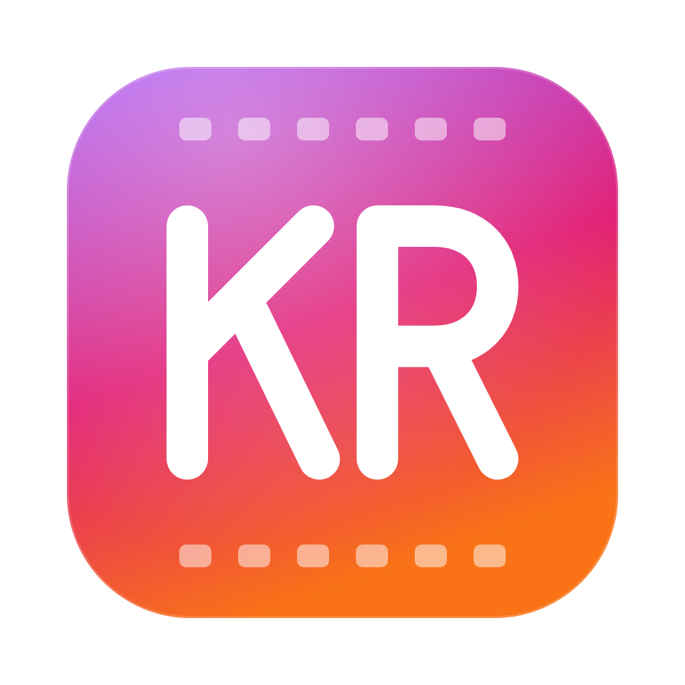

<p align="center">
  
</p>

<h1 align="center">KlikReel</h1>

<p align="center">
  A free, open-source desktop app that turns a prompt and your codebase into a narrated product promo video. Bring your own AI keys; projects stay on your machine.
</p>

<p align="center">
  <a href="LICENSE"></a>
  
  
  
  <a href="https://github.com/ashafizullah/klikreel/actions/workflows/ci.yml"></a>
  <a href="https://github.com/ashafizullah/klikreel/releases/latest"></a>
  <a href="https://github.com/ashafizullah/klikreel/releases"></a>
</p>

<p align="center">
  <a href="https://trakteer.id/adamshafizullah/tip"></a>
</p>

<p align="center">
  Part of <a href="https://klikapps.pages.dev"><b>Klik Apps</b></a>, a family of free, open-source desktop apps: <a href="https://klikapps.pages.dev">klikapps.pages.dev</a>
</p>

## Features

- **Prompt → video**: point it at a project folder, describe the feature to promote, and the AI researches the code (UI labels, brand colors, logo, screenshots) and writes a storyboard
- **Animated scenes** as self-contained HTML + GSAP pages, rendered frame by frame so preview and export match
- **AI voiceover** with OpenAI-compatible TTS or xAI, directed per scene (pauses, emphasis, energy) and fitted to each scene's length
- **Background music**, timeline editing, and an HTML code editor (Monaco) for every scene
- **Revise by chat**: ask the AI to change a scene, its narration or the order, and it edits the storyboard for you
- **Bring your own model**: Anthropic or any OpenAI-compatible API; keys are stored in the OS keychain
- **Built-in terminal** (Ctrl+`) opened in your project folder
- **Works with Claude Code**: turn on the local MCP server and your own Claude Code can edit scenes, write their HTML, record voiceovers, take snapshots and export
- **Export** to MP4 with headless Chrome and ffmpeg
- **Auto-update** from GitHub Releases (signed packages; checked daily, or via *Check for updates* on the home screen)
- **English and Bahasa Indonesia** interface

## Using Claude Code

KlikReel can be driven by [Claude Code](https://claude.com/claude-code) installed on your own computer, signed in with your own account (including Pro/Max plans):

1. Open a video project, open the terminal (Ctrl+`) and click **Connect Claude Code**.
2. Enable the local MCP server and copy the `claude mcp add …` command. Run it once in any terminal.
3. Start `claude` and ask for changes, e.g. *"rewrite the opening scene so it shows the dashboard"*. Edits appear live in KlikReel and can be undone.

The server only listens on `127.0.0.1` and requires a secret token. KlikReel never launches Claude Code, sends it prompts, reads its output or touches your Claude credentials: you add the server and run Claude Code yourself.

## Download

Get the latest version from **[Releases](https://github.com/ashafizullah/klikreel/releases/latest)**:

| Platform | File |
|---|---|
| macOS 11+ (Apple Silicon & Intel) | `KlikReel_x.y.z_universal.dmg` |
| Windows 10/11 (x64) | `KlikReel_x.y.z_x64-setup.exe` or `.msi` |
| Linux x86_64 | `.deb`, `.rpm` or `.AppImage` |

**macOS:** open the DMG and drag KlikReel into Applications. KlikReel is signed and notarized by Apple, so it opens without a Gatekeeper warning. Or use the install script, which downloads the latest DMG, copies KlikReel into Applications and opens it:

```sh
curl -fsSL https://raw.githubusercontent.com/ashafizullah/klikreel/main/install.sh | bash
```

**Windows:** SmartScreen may warn about an unsigned app. Click **More info → Run anyway**.

## Requirements

- [ffmpeg](https://ffmpeg.org/) (`brew install ffmpeg` on macOS)
- Google Chrome, Chromium, Edge or Brave (used for rendering)
- An API key for a chat model, and one for text-to-speech if you want voiceovers

## Development

Requires [Bun](https://bun.sh/) and stable Rust.

```sh
bun install
bun run tauri dev      # run
bun run tauri build    # bundle
bun run test           # frontend tests
cargo test --manifest-path src-tauri/Cargo.toml
```

## Contributing

Issues and pull requests are welcome. CI runs type checks, tests, `cargo fmt`, `clippy` and `cargo test` on macOS, Windows and Linux. Please run them locally before opening a PR. See [CONTRIBUTING.md](CONTRIBUTING.md) for setup, checks and guidelines.

### Releasing

Add a `## x.y.z` section to `CHANGELOG.md`, bump `version` in `tauri.conf.json`, `Cargo.toml` and `package.json`, then push a tag. CI builds the signed and notarized macOS DMG, the Windows installers and the Linux packages, signs the update packages and attaches everything (including `latest.json` for the in-app updater) to a draft release. Publish the draft to roll it out: installed apps only see published releases.

Releases need the `TAURI_SIGNING_PRIVATE_KEY` secret (its public key is in `tauri.conf.json`) plus `APPLE_CERTIFICATE`, `APPLE_CERTIFICATE_PASSWORD`, `APPLE_ID`, `APPLE_PASSWORD` and `APPLE_TEAM_ID` for macOS signing and notarization.

```sh
git tag v0.1.0 && git push origin v0.1.0
```

## Support

KlikReel is free. If it saves you time, **[buy me an AI token on Trakteer](https://trakteer.id/adamshafizullah/tip)** ☕🤖.

## License

[MIT](LICENSE)

The app bundles third-party software, including the interface fonts Fraunces, IBM Plex Sans and IBM Plex Mono (SIL Open Font License 1.1). Their licenses are in [`THIRD_PARTY_NOTICES.md`](THIRD_PARTY_NOTICES.md), which the app also shows under Settings → Open-source licenses. Run `bun run notices` after changing dependencies.

Claude and Claude Code are trademarks of Anthropic. KlikReel is an independent project and is not affiliated with or endorsed by Anthropic.
